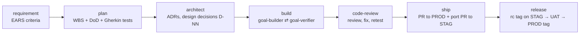

# Case study: an AI-agent workflow for Spec-Driven Development

**Role:** designer and maintainer (process design, decisions, review, release) ·
**Tools:** Claude Code (skills, subagents, plugins), Bash, Git, GitHub CLI

> I designed and ran a Claude Code plugin that lets AI agents take a product
> change from requirement to production release, while people approve every
> decision that matters. I improved it over 8 versions, using feedback from
> its real use on a product repo.

## At a glance

| | |
|---|---|
| Delivered | 1 plugin: 15 skills, 3 subagents, 13 Bash scripts (~1,150 lines), shared conventions, onboarding guide |
| Feedback loop | 20 GitHub issues + 11 queued reports from real use, all resolved; each issue closed within 2 days of being filed |
| Quality | Every change round was checked by an independent review agent before release. Each round found real problems (5–16 per round), and all were fixed |
| Measured effect | Mid-build pauses for decisions: ~6 per version → 1 in the next version, after moving design decisions upfront (details below) |

## 1. The problem

The team was starting to use AI coding agents on a product monorepo (Java/Spring
Boot + TypeScript/Next.js). Prompting by hand gave uneven results:
- requirements, plans and tests were not written down in one consistent way;
- nothing defined when a person must approve something and when the agent may go on;
- version numbers, branches and tags for the staging and production environments
  were handled by hand;
- agent mistakes were found late, often only in review.

**Goal:** one repeatable, stack-independent workflow. Agents draft, implement,
test and open pull requests; people decide at defined gates.

## 2. What I built

A Claude Code plugin (`engineer`) implementing Spec-Driven Development:

- **Skills, one per phase.** `requirement`, `plan`, `architect`, `build`,
  `code-review`, `ship` and `release` are the phases. `status`, `guide`,
  `feedback` and `init-docs` help users and set up new repos.
- **Subagents with separate roles.** `goal-builder` implements exactly one plan
  goal. `goal-verifier` checks that goal independently and read-only, against
  its Definition of Done, the tests, the design decisions and the commit rules,
  and returns PASS or FAIL. `codebase-analyzer` reports how an existing codebase
  is actually built before anything is planned on top of it.
- **Deterministic scripts for everything that must not be left to an LLM.**
  These cover version calculation and reservation, branch creation, commit
  validation (Conventional Commits plus traceability trailers), cherry-pick
  porting between environments, drift detection, and test-report freshness.
- **A single conventions document** that every skill and agent reads, so the
  rules live in one place.
- **A built-in feedback loop.** Each skill ends with a silent retrospective
  that queues problems with the workflow itself. These are filed as GitHub
  issues, triaged, fixed and shipped as a new plugin version.

## 3. Key design decisions and trade-offs

1. **People own decisions; agents own execution.** Every phase ends at a
   gate where a person approves the requirement, the plan, the design or the
   release. An `--approved` mode lets a trusted run approve its own proposals,
   but some actions *always* go back to a person: scope changes, failing or
   newly skipped tests, changes to invariants or earlier architecture decisions,
   force-push, merges and tags. Skipping tests is a flag only a person may pass;
   an agent can never choose it.
2. **Builder and verifier are separate agents.** The agent that writes the code
   never marks its own work done. The verifier is read-only and needs evidence
   for each Definition-of-Done item.
3. **Design is decided up front, with an owner for every decision.** Each design
   decision gets an ID, a rationale and an approver. The builder treats them as
   binding and escalates anything outside them instead of guessing.
4. **LLM for judgment, scripts for mechanics.** Git and versioning logic runs in
   tested Bash, which keeps it repeatable and reviewable. Agents call the
   scripts; they do not re-implement them in prompts.
5. **Traceability.** Every commit carries a `Refs: vX.Y.Z.T/G-NN` trailer that
   links it to a plan goal. The verifier and the ship step check it.
6. **Branches per environment.** `main` = staging and `release` = production.
   A version is built once and ported to staging with `cherry-pick -x`.
   Staging always goes first, and promotion to production waits for UAT.

## 4. How I worked with the agents

- **Design before code.** I wrote the process design and settled each open
  question (branch model, version scheme, gates) before any agent implemented
  anything.
- **Small, verifiable rounds.** In each round an agent implemented a set of
  changes. Then:
  - syntax checks and `claude plugin validate`;
  - script tests in throwaway git repos covering edge cases;
  - an **independent review agent** that had not written the code.
- **Nothing outward-facing without approval.** Pushes, issues, labels and
  releases needed my explicit go-ahead, and production promotion stayed manual.

## 5. Iterating on real feedback

| Version | Driven by | Main change |
|---|---|---|
| 0.2 | design | Full workflow: 8 user-facing skills, 5 helper skills, 3 agents, 6 scripts |
| 0.3 | issues #1–#9 | Repos with their own docs layout, scope-change flow, approval gates in Definition of Done, skipped-test tracking, UAT waiver |
| 0.4 | issues #10–#14 | Architect delivers the complete design, so build only executes |
| 0.4.1 | issue #15 | Exceptions to enforced conventions become explicit design decisions |
| 0.5 | issues #16–#20 | Sharper plan and design checks; zsh fix; test reports stay valid across docs-only changes |
| 0.6 | my roadmap | Code-review phase; `--approved` mode with hard limits |
| 0.7 | 11 queued reports | `--skip-test` (user-only); reviewer selection that copes with harness limits; design checks behind 9 build-time decisions |

**Example of the loop working.** In one version under 0.3, the build stopped
about 6 times to ask decisions the design could have settled. I changed the
role split. The architect now has to deliver the complete design, with
principles for input sources, end-to-end failure paths, abuse and
shared-resource analysis, and parameters that can only be measured. The next
version needed **1** unforeseen decision. That one came from a lint convention,
so in 0.4.1 the architect also checks decisions against enforced conventions.
A later, larger version still produced 9 build-time decisions. The retro
captured them, and the questions behind them became new design checks in 0.7.
The loop keeps improving the workflow; it does not claim to be finished.

## 6. Problems worth telling

- **Silent auth failure.** The agent's GitHub token was an app-scoped token
  that could not see the organisation, so `gh` failed in confusing ways. I added
  a wrapper that detects the access error and retries with the user's own login.
- **Shell portability.** Users ran the skills under zsh, which does not split
  a command stored in a variable (`GH="bash gh.sh"`). That broke ship and
  release. Fixed by calling the script directly, and the convention now forbids
  the pattern.
- **Harness limits.** The built-in `/code-review` reviews "the current
  directory", but the agent shell reset its directory after every command, so
  the review could look at the wrong tree. I added a check (does the directory
  persist? do the findings name the expected files?) and a fallback to review
  agents working on absolute paths.
- **Catching the agent's own bugs.** Review and tests caught dangerous code
  written by the agent before it shipped:
  - a cleanup path that could run `rm -f /dev/null`;
  - a script that hung waiting on stdin;
  - a verifier rule that would have failed every goal in `--approved` mode;
  - a drift check that took 45 s, now 0.5 s.

## 7. What I learned

- An agent workflow is only as reliable as its gates and its verifier. A
  builder that also checks its own work is not enough.
- Write the boundaries of autonomy down explicitly (what is pre-approved, what
  never is) and keep them in one place.
- Put deterministic work in scripts and test them like product code.
- Make the workflow report its own friction. Most improvements came from that
  feedback, not from my original design.

## 8. Next steps

- CI/CD deployment triggered by the staging and production tags.
- Track per version: decisions raised at build time, verifier FAIL rate,
  review findings, and lead time from requirement to production.
- [TODO: anything planned with the team]

---
*All code and documents were written by AI agents (Claude Code) under my
direction. My contribution: the process design and the decisions in it,
defining gates and boundaries, reviewing and testing every change, triaging
feedback, and releasing.*
