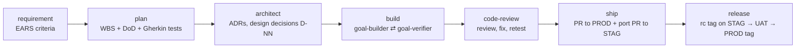

# Case study: quy trình làm việc với AI agent cho Spec-Driven Development

**Vai trò:** người thiết kế và duy trì (thiết kế quy trình, ra quyết định, review, release) ·
**Công cụ:** Claude Code (skills, subagents, plugins), Bash, Git, GitHub CLI

> Tôi đã thiết kế và vận hành một plugin Claude Code cho phép AI agent đưa một
> thay đổi sản phẩm đi từ requirement đến release production, trong khi con người
> phê duyệt mọi quyết định quan trọng. Tôi đã cải tiến plugin qua 8 phiên bản, dựa
> trên phản hồi từ việc dùng thật trên một repo sản phẩm.

## Tóm tắt nhanh

| | |
|---|---|
| Kết quả bàn giao | 1 plugin: 15 skill, 3 subagent, 13 script Bash (~1.150 dòng), bộ quy ước dùng chung, hướng dẫn onboarding |
| Vòng phản hồi | 20 GitHub issue + 11 báo cáo xếp hàng từ việc dùng thật, tất cả đã được xử lý; mỗi issue được đóng trong vòng 2 ngày kể từ khi tạo |
| Chất lượng | Mỗi đợt thay đổi đều được một review agent độc lập kiểm tra trước khi release. Đợt nào cũng phát hiện vấn đề thật (5–16 vấn đề mỗi đợt), và tất cả đều đã được sửa |
| Hiệu quả đo được | Số lần dừng giữa chừng lúc build để chờ quyết định: ~6 lần mỗi phiên bản → 1 lần ở phiên bản kế tiếp, sau khi đưa các quyết định thiết kế lên làm trước (chi tiết bên dưới) |

## 1. Vấn đề

Nhóm bắt đầu dùng AI coding agent trên một monorepo sản phẩm (Java/Spring
Boot + TypeScript/Next.js). Viết prompt thủ công cho kết quả không đồng đều:
- requirement, kế hoạch và test không được ghi lại theo một cách thống nhất;
- không có quy định khi nào con người phải phê duyệt và khi nào agent được tự làm tiếp;
- số phiên bản, branch và tag cho môi trường staging và production
  đều được xử lý thủ công;
- lỗi của agent bị phát hiện muộn, thường chỉ đến lúc review.

**Mục tiêu:** một quy trình lặp lại được và không phụ thuộc vào tech stack. Agent soạn thảo,
triển khai, test và mở pull request; con người ra quyết định tại các cổng phê duyệt đã định sẵn.

## 2. Những gì tôi đã xây dựng

Một plugin Claude Code (`engineer`) triển khai Spec-Driven Development:

- **Mỗi giai đoạn một skill.** `requirement`, `plan`, `architect`, `build`,
  `code-review`, `ship` và `release` là các giai đoạn. `status`, `guide`,
  `feedback` và `init-docs` hỗ trợ người dùng và thiết lập repo mới.
- **Các subagent với vai trò tách biệt.** `goal-builder` triển khai đúng một mục
  tiêu trong kế hoạch. `goal-verifier` kiểm tra mục tiêu đó một cách độc lập và chỉ đọc,
  đối chiếu với Definition of Done, các test, các quyết định thiết kế và quy tắc commit,
  rồi trả về PASS hoặc FAIL. `codebase-analyzer` báo cáo một codebase có sẵn
  thực sự được xây dựng thế nào trước khi lập kế hoạch bất cứ điều gì trên nó.
- **Script tất định cho mọi việc không được phép giao cho LLM.**
  Bao gồm tính toán và giữ chỗ số phiên bản, tạo branch, kiểm tra commit
  (Conventional Commits cùng trailer truy vết), port giữa các môi trường bằng
  cherry-pick, phát hiện sai lệch (drift) và kiểm tra test report còn cập nhật hay không.
- **Một tài liệu quy ước duy nhất** mà mọi skill và agent đều đọc, để các quy tắc
  nằm ở một chỗ.
- **Vòng phản hồi tích hợp sẵn.** Mỗi skill kết thúc bằng một buổi retro chạy ngầm,
  ghi lại các vấn đề của chính quy trình vào hàng đợi. Những vấn đề này được tạo thành
  GitHub issue, được phân loại, sửa và phát hành thành phiên bản plugin mới.

## 3. Các quyết định thiết kế chính và đánh đổi

1. **Con người nắm quyết định; agent lo thực thi.** Mỗi giai đoạn kết thúc tại một
   cổng phê duyệt, nơi con người duyệt requirement, kế hoạch, thiết kế hoặc
   release. Chế độ `--approved` cho phép một lần chạy đáng tin cậy tự duyệt đề xuất của mình,
   nhưng một số hành động *luôn luôn* phải quay về con người: thay đổi phạm vi, test bị lỗi
   hoặc test mới bị bỏ qua, thay đổi invariant hay các quyết định kiến trúc trước đó,
   force-push, merge và tag. Bỏ qua test là một flag chỉ con người được truyền vào;
   agent không bao giờ được tự chọn.
2. **Builder và verifier là hai agent riêng.** Agent viết code
   không bao giờ tự đánh dấu công việc của mình là xong. Verifier chỉ có quyền đọc và cần
   bằng chứng cho từng mục Definition of Done.
3. **Thiết kế được quyết định từ trước, mỗi quyết định có người chịu trách nhiệm.** Mỗi quyết định
   thiết kế có một ID, lý do và người phê duyệt. Builder coi chúng là
   ràng buộc bắt buộc và báo lên (escalate) mọi điều nằm ngoài phạm vi đó thay vì tự đoán.
4. **LLM để phán đoán, script để làm phần cơ học.** Logic Git và đánh phiên bản chạy bằng
   Bash đã được test, nhờ vậy lặp lại được và dễ review. Agent gọi các
   script; chúng không viết lại logic đó trong prompt.
5. **Truy vết.** Mỗi commit mang một trailer `Refs: vX.Y.Z.T/G-NN` để
   liên kết với một mục tiêu trong kế hoạch. Verifier và bước ship đều kiểm tra trailer này.
6. **Mỗi môi trường một branch.** `main` = staging và `release` = production.
   Một phiên bản được build một lần và port sang staging bằng `cherry-pick -x`.
   Staging luôn đi trước, và việc đưa lên production phải chờ UAT.

## 4. Cách tôi làm việc với các agent

- **Thiết kế trước khi viết code.** Tôi viết bản thiết kế quy trình và chốt từng câu hỏi
  còn mở (mô hình branch, cách đánh phiên bản, các cổng phê duyệt) trước khi bất kỳ agent nào
  triển khai gì.
- **Các đợt nhỏ, kiểm chứng được.** Trong mỗi đợt, một agent triển khai một nhóm
  thay đổi. Sau đó:
  - kiểm tra cú pháp và `claude plugin validate`;
  - test script trong các git repo dùng một lần, bao phủ các trường hợp biên;
  - một **review agent độc lập**, không phải agent đã viết code.
- **Không có gì ra bên ngoài khi chưa được duyệt.** Push, issue, label và
  release đều cần tôi đồng ý rõ ràng, và việc đưa lên production vẫn làm thủ công.

## 5. Cải tiến dựa trên phản hồi thực tế

| Phiên bản | Động lực | Thay đổi chính |
|---|---|---|
| 0.2 | thiết kế | Quy trình đầy đủ: 8 skill cho người dùng, 5 skill hỗ trợ, 3 agent, 6 script |
| 0.3 | issue #1–#9 | Hỗ trợ repo có cấu trúc docs riêng, luồng thay đổi phạm vi, cổng phê duyệt trong Definition of Done, theo dõi test bị bỏ qua, miễn UAT |
| 0.4 | issue #10–#14 | Architect bàn giao thiết kế hoàn chỉnh, để build chỉ việc thực thi |
| 0.4.1 | issue #15 | Các ngoại lệ đối với quy ước bắt buộc trở thành quyết định thiết kế tường minh |
| 0.5 | issue #16–#20 | Kiểm tra kế hoạch và thiết kế chặt hơn; sửa lỗi zsh; test report vẫn hợp lệ khi chỉ thay đổi docs |
| 0.6 | lộ trình của tôi | Giai đoạn code-review; chế độ `--approved` với các giới hạn cứng |
| 0.7 | 11 báo cáo xếp hàng | `--skip-test` (chỉ người dùng được dùng); chọn reviewer phù hợp với giới hạn của harness; các bước kiểm tra thiết kế rút ra từ 9 quyết định phát sinh lúc build |

**Ví dụ về vòng phản hồi hoạt động thế nào.** Ở một phiên bản dùng 0.3, quá trình build dừng lại
khoảng 6 lần để hỏi những quyết định mà lẽ ra thiết kế đã có thể chốt. Tôi thay đổi
cách phân chia vai trò. Giờ đây architect phải bàn giao thiết kế hoàn chỉnh, với
nguyên tắc cho các nguồn dữ liệu đầu vào, các luồng lỗi từ đầu đến cuối, phân tích
lạm dụng và tài nguyên dùng chung, cùng các tham số chỉ có thể đo được trong thực tế. Phiên bản
tiếp theo chỉ cần **1** quyết định ngoài dự kiến. Quyết định đó đến từ một quy ước lint,
nên ở 0.4.1 architect còn kiểm tra các quyết định với các quy ước bắt buộc.
Một phiên bản sau, lớn hơn, vẫn phát sinh 9 quyết định lúc build. Buổi retro đã
ghi lại chúng, và những câu hỏi đằng sau trở thành các bước kiểm tra thiết kế mới trong 0.7.
Vòng phản hồi tiếp tục cải thiện quy trình; nó không tự nhận là đã hoàn thiện.

## 6. Những vấn đề đáng kể lại

- **Lỗi xác thực không báo lỗi rõ ràng.** GitHub token của agent là token giới hạn theo app,
  không nhìn thấy được organisation, nên `gh` lỗi theo những cách khó hiểu. Tôi thêm
  một wrapper phát hiện lỗi truy cập và thử lại bằng tài khoản đăng nhập của chính người dùng.
- **Tính tương thích giữa các shell.** Người dùng chạy skill dưới zsh, vốn không tách
  một lệnh được lưu trong biến (`GH="bash gh.sh"`). Điều đó làm hỏng ship và
  release. Đã sửa bằng cách gọi script trực tiếp, và bộ quy ước giờ cấm
  cách viết này.
- **Giới hạn của harness.** `/code-review` tích hợp sẵn review "thư mục
  hiện tại", nhưng shell của agent lại reset thư mục sau mỗi lệnh, nên
  việc review có thể nhìn nhầm cây thư mục. Tôi thêm một bước kiểm tra (thư mục có
  được giữ nguyên không? các phát hiện có nêu đúng các file mong đợi không?) và phương án dự phòng là
  các review agent làm việc trên đường dẫn tuyệt đối.
- **Bắt được lỗi do chính agent tạo ra.** Review và test đã phát hiện code nguy hiểm
  do agent viết trước khi nó được phát hành:
  - một luồng dọn dẹp có thể chạy `rm -f /dev/null`;
  - một script bị treo vì chờ stdin;
  - một quy tắc của verifier lẽ ra sẽ đánh FAIL mọi mục tiêu ở chế độ `--approved`;
  - một bước kiểm tra drift mất 45 giây, nay còn 0,5 giây.

## 7. Những điều tôi rút ra

- Một quy trình dùng agent chỉ đáng tin cậy bằng các cổng phê duyệt và verifier của nó. Một
  builder tự kiểm tra công việc của mình là không đủ.
- Hãy ghi rõ ranh giới tự chủ của agent (điều gì được duyệt sẵn, điều gì
  không bao giờ được) và giữ chúng ở một chỗ.
- Đưa phần việc tất định vào script và test chúng như code sản phẩm.
- Để quy trình tự báo cáo những điểm vướng của chính nó. Phần lớn cải tiến đến từ
  phản hồi đó, chứ không phải từ thiết kế ban đầu của tôi.

## 8. Bước tiếp theo

- Triển khai CI/CD được kích hoạt bởi tag staging và production.
- Theo dõi theo từng phiên bản: số quyết định phát sinh lúc build, tỉ lệ FAIL của verifier,
  số phát hiện khi review, và thời gian từ requirement đến production.
- [TODO: những gì đã lên kế hoạch cùng nhóm]

---
*Toàn bộ code và tài liệu được viết bởi AI agent (Claude Code) dưới sự chỉ đạo
của tôi. Phần đóng góp của tôi: thiết kế quy trình và các quyết định trong đó,
xác định các cổng phê duyệt và ranh giới, review và test mọi thay đổi, phân loại
phản hồi, và phát hành.*
