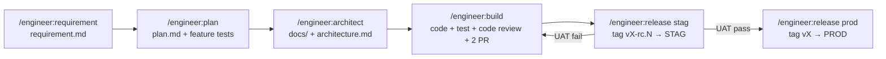

# Hướng dẫn Agentic SDD

Bộ hướng dẫn sử dụng plugin `engineer` để phát triển sản phẩm theo quy trình
**Agentic SDD** (Spec-Driven Development). Tài liệu chia theo khung
[Diátaxis](https://diataxis.fr/):

| Bạn cần… | Đọc |
|---|---|
| Làm thử từ đầu đến cuối một lần | [Tutorial — Chu trình đầu tiên](tutorial.md) |
| Làm một việc cụ thể (UAT fail, conflict, huỷ version…) | [How-to](how-to.md) |
| Tra cứu lệnh, version, tag, cấu trúc file | [Reference](reference.md) |
| Hiểu vì sao quy trình được thiết kế như vậy | [Explanation](explanation.md) |

Trong Claude Code, gõ `/engineer:guide` để được hướng dẫn tương tác, hoặc
`/engineer:status` để biết repo đang ở bước nào.

## Quy trình trong một hình

Mỗi mũi tên là một **cổng duyệt**: agent dừng lại, bạn đọc và chốt, rồi mới
sang bước sau.
