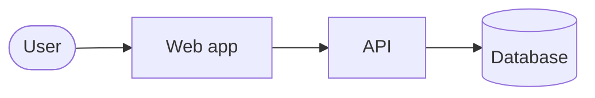

# Architecture — __TITLE__ (__VERSION__)

The builder reads this file first. It summarizes what changed in `docs/` for
this version and how each goal should fit the architecture.

## Summary
Two to five sentences: the shape of the solution and the main decision(s).

## Impacted components

| Component | Change | Doc |
|-----------|--------|-----|
| … | new / changed / unchanged-but-touched | `docs/01-architecture/components/….md` |

## Decisions

| ADR | Title | Status |
|-----|-------|--------|
| ADR-NNNN | … | Accepted |

## Invariants

| ID | Rule | Change |
|----|------|--------|
| INV-NNN | … | new / changed (via ADR-NNNN) |

## Data model changes
Entities, fields, migrations, backfills. "None" if none.

## API / contract changes
Endpoints, events, schemas, with compatibility notes. "None" if none.

## Dependencies
Libraries or services added, upgraded, or removed, with the ADR that allows it.

## Diagram

C4 container view of the parts this version touches (Mermaid).

## Design decisions

Every decision the build needs, taken now ("Design decisions (D-NN)" in the
conventions). Approve all `approved:` rows together at the architect gate.

| ID | Question | Decision | Rationale | Authority | Goals |
|----|----------|----------|-----------|-----------|-------|
| D-01 | Where does <input> of G-02 come from? | <source>; rejected: <alternative> | … | approved: PO <name>, <date> | G-02 |
| D-02 | <parameter> value | target <x>; builder picks the value by measuring <y> | only measurable on real data | builder: within <range> | G-03 |

## Build-time decisions

Decisions that could not be foreseen, added by `/engineer:build` after the
user approved them (same columns, numbering continues). Empty when the design
was complete.

| ID | Question | Decision | Rationale | Authority | Goals |
|----|----------|----------|-----------|-----------|-------|

## Guidance per goal

### G-01
Where it lives, patterns to follow (cite `docs/04-conventions/…`, ADRs,
invariants), pitfalls to avoid. No step-by-step code.

## Test strategy
Frameworks and commands (must match `docs/04-conventions/testing.md`), how the
automated feature tests are wired, test data and environments.

## Risks
Anything the builder should watch for. No open questions here: each one is
either a decision above or a spike goal in `plan.md`.
